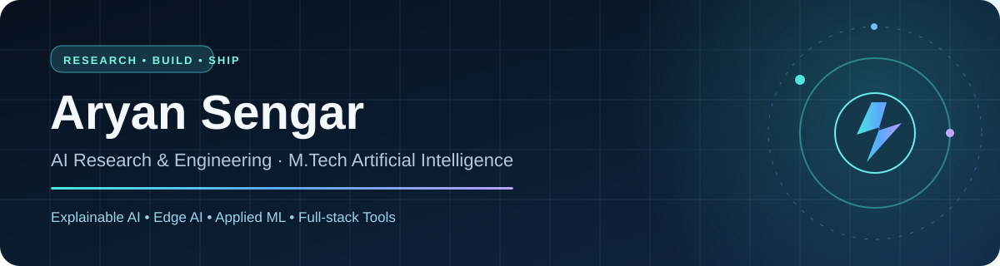

  

  <h2>Hi, I'm Aryan 👋</h2>
  
<strong>M.Tech Artificial Intelligence student · AI project builder · Research-minded developer</strong>

  
Exploring how machine learning, explainable AI, edge computing, and useful software can solve practical problems.

  
  
  

  

    
    
    
    
    
    
  

---

### ✦ About me

- 🎓 Studying **M.Tech in Artificial Intelligence** at **Amity University, Lucknow**.
- 🔬 Interested in **explainable AI, machine learning, neural networks, edge AI, TinyML, and RAG architectures**.
- 🛠️ Building web tools and practical software with **Python, JavaScript, Node.js, and relational databases**.
- 📄 Learning through research papers, laboratory implementations, experiments, and applied projects.
- 🌐 Portfolio: **[AI & Engineering Journey](https://ai-journey-engineering-portfolio.leafyhutch64.chatgpt.site)**

### 🚀 Featured build: AI Octopus

<table>
<tr>
<td width="65%" valign="top">

**[AI Octopus — Writing & Document Workspace](https://github.com/dapperdude404/octo)**

An evolving web + Android project bringing together writing-pattern analysis, clarity edits, grammar review, document utilities, and optional provider-based checks.

- **Document Studio:** PDF/DOCX text imports; DOCX, TXT, HTML, Markdown, and JSON text exports; browser print-to-PDF
- **Design:** user-selectable Aurora, Plasma, and Solar palettes
- **Stack:** Node.js, Express, PostgreSQL, Prisma, Capacitor
- **Delivery:** GitHub Pages, Render API, GitHub Releases, Android debug builds

The browser's writing-pattern score is **heuristic**, not proof of authorship. Optional third-party services require configured API credentials.

</td>
<td width="35%" valign="top">

**Project snapshot**

| Area | Focus |
|:--|:--|
| Web | Writing workspace |
| Mobile | Android debug build |
| Docs | PDF / DOCX tools |
| API | Node.js / Express |
| Data | PostgreSQL |
| Themes | Aurora / Plasma / Solar |

</td>
</tr>
</table>

### 🧩 Projects & work

| Project | What I'm exploring |
|:--|:--|
| **[AI Octopus](https://github.com/dapperdude404/octo)** | AI-assisted writing workflows, document tools, web/Android deployment, and practical full-stack engineering |
| **AS Solar Geek** | Solar-product commerce interface, product management, customer/order workflows, and reporting concepts |
| **Online Library Management System** | Software-project scheduling, resource planning, and ProjectLibre work |
| **M.Tech AI laboratory work** | Regression, KNN, clustering, preprocessing, neural networks, and IoT/edge deployment concepts |

### 🧠 Research & academic focus

<table>
<tr><td valign="top" width="50%">

**Artificial Intelligence**

- Machine learning & data mining
- Model evaluation and preprocessing
- CNNs, neural networks & deep learning
- TinyML and edge AI
- Explainability and RAG architectures

</td><td valign="top" width="50%">

**Engineering & practice**

- Python, NumPy, Pandas, SciPy
- Scikit-learn, PyTorch, TensorFlow
- JavaScript, Node.js, Git/GitHub
- PostgreSQL, MySQL & Prisma
- Project planning, documentation, testing

</td></tr>
</table>

<strong>📚 Explore my M.Tech coursework & lab notes</strong>

 

My academic work includes:

1. **Machine Learning & Data Mining:** linear regression, KNN, K-means, hierarchical clustering, entropy, and feature preprocessing.
2. **Neural Networks & Edge AI:** convolutional architectures, ANN pipelines, pixel representations, and TinyML quantization.
3. **Advanced Software Project Management:** COCOMO II, function points, PERT/CPM, and earned-value metrics.
4. **Professional Communication:** persuasive communication, message framing, and evidence-based decision-making.
5. **German A1:** vocabulary, verb conjugation, self-introductions, and time expressions.

📖 **[Read the detailed academic portfolio and working examples](./M.Tech%20AI%20Portfolio%20README.md)**

### 🛠️ Toolbelt

  

### 🌐 Connect

  <a href="https://github.com/dapperdude404">GitHub</a>
  &nbsp;•&nbsp;
  <a href="https://ai-journey-engineering-portfolio.leafyhutch64.chatgpt.site">Portfolio</a>
  &nbsp;•&nbsp;
  <a href="https://www.instagram.com/singh_shab_whole_night/">Instagram</a>
  &nbsp;•&nbsp;
  <a href="https://www.snapchat.com/add/mariya_luis22">Snapchat</a>

---

Curiosity → Research → Build → Test → Improve · Profile curated for clarity, with academic details preserved in the companion portfolio README.

